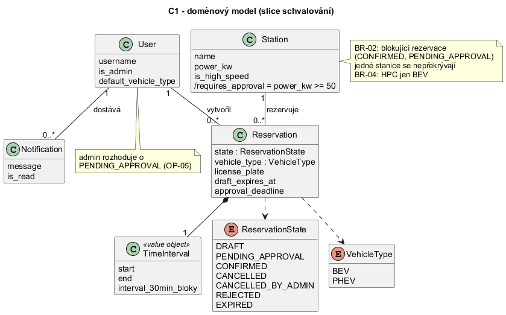
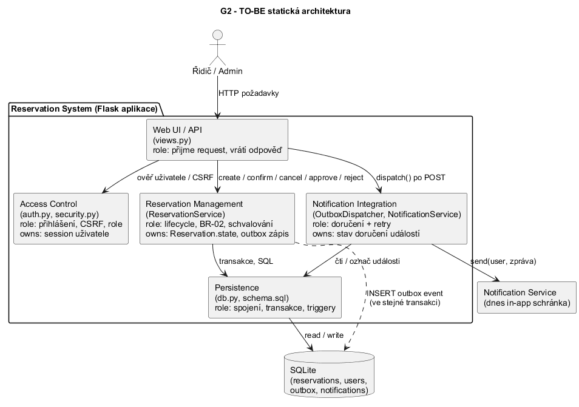
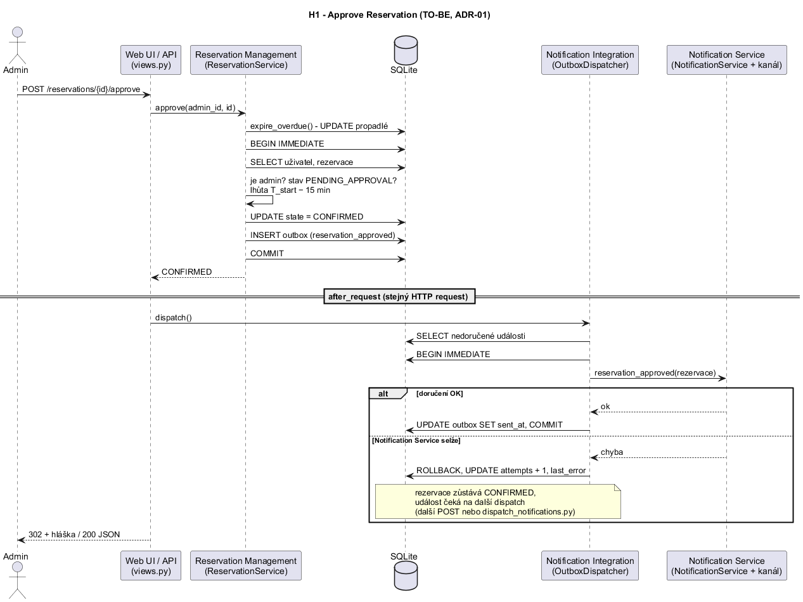
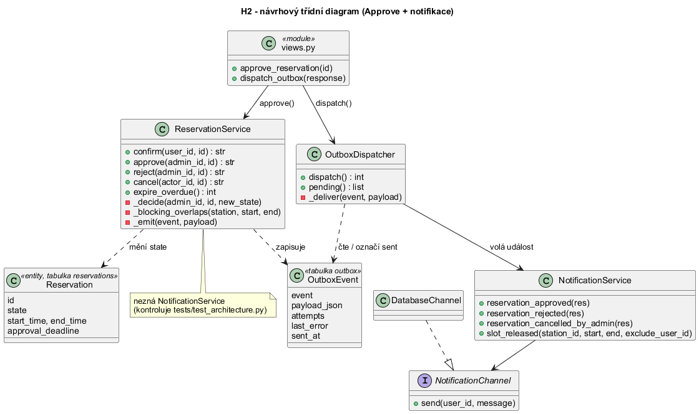

# Architecture and decisions

---

# CV1 (C01)

## Přehled

*Vzniklo v CV1, v CV3 doplněný outbox pro notifikace.*

```
Prohlížeč / HTTP klient
        │
        ▼
Flask (views.py, auth.py, security.py)      ← HTTP, přihlášení, CSRF, formuláře, JSON API
        │                                       po každém POST spustí OutboxDispatcher.dispatch()
        ▼
ReservationService (services/reservations.py) ← doménová logika: stavy, pravidla, dostupnost
        │  změna stavu + událost do outboxu v jedné transakci (ADR-01)
        ▼
SQLite (schema.sql)  ◄── OutboxDispatcher (services/outbox.py) ──► NotificationService ──► NotificationChannel
 tabulky, outbox,          čte a označuje události                  (services/notifications.py)   (dnes DatabaseChannel =
 CHECK + triggery                                                    ← boundary                    in-app schránka)
```

## Rozhodnutí z CV1

### D1 – Stack: Python + Flask + SQLite + pytest
- **Kontext:** malý tým, krátký semestr, požadavek na funkční DB a přihlašování; stack si tým podporuje sám.
- **Rozhodnutí:** Flask (minimum „magie“, celý request je čitelný v jednom souboru), SQLite (součást Pythonu – žádný DB server k instalaci, clean checkout se spustí dvěma příkazy), pytest.
- **Důsledky:** SQLite má jednoho zapisujícího najednou – pro školní provoz dostačuje, ale je to přesně místo, na které míří zvolená future pressure (Q). Přechod na PostgreSQL by znamenal přepsat triggery (nebo použít exclusion constraint `tstzrange`) a připojení v `db.py`; doménová logika zůstává.

### D2 – Business pravidla vynucujeme dvakrát: ve službě i v databázi
*V CV2 doplněné nové triggery pro baseline v0.2.*
- **Rozhodnutí:** `ReservationService` kontroluje pravidla a vrací srozumitelné chyby; triggery v `schema.sql` (`BLOCKING_OVERLAP`, `HIGH_SPEED_BEV_ONLY`, `INVALID_STATE_TRANSITION`, `INVALID_INITIAL_STATE`, `APPROVAL_REQUIRED`) jsou pojistka proti chybě v kódu, ručnímu zásahu do DB i souběhu. Časová pravidla (5 min, T_start − 15 min, 30 min) hlídá jen služba – DB nezná „teď“ aplikace.
- **Souběh:** operace běží v `BEGIN IMMEDIATE` transakci – kontrola dostupnosti a zápis jsou atomické.
- **Důsledky:** pravidlo je na dvou místech; testy ověřují obě vrstvy zvlášť.

### D3 – Časy jako text `YYYY-MM-DD HH:MM` v lokálním čase, sloty po 30 min
- **Rozhodnutí:** formát je lexikograficky řaditelný, takže překryv `a.start < b.end AND b.start < a.end` funguje přímo v SQL. Zarovnání na :00/:30 hlídá služba i `CHECK`.
- **Důsledky:** nepodporujeme více časových pásem; přechod letního/zimního času není řešen (viz Unknown v Project Frame).

### D4 – Schvalování jen pro DC/HPC, žádost PENDING_APPROVAL blokuje slot (C02, baseline v0.2)
*V CV1 se schvalovala každá rezervace, v CV2 přepsáno podle baseline v0.2.*
- **Původně (C01):** schvalovaly se všechny rezervace a překrývající se žádosti PENDING mohly existovat současně.
- **Rozhodnutí:** OP-03 Confirm na AC stanici vede rovnou do CONFIRMED, na stanici ≥ 50 kW (DC 07, HPC 08–10) do PENDING_APPROVAL. Žádost blokuje slot stejně jako CONFIRMED (BR-02), takže admin nikdy neschvaluje termín, který mezitím obsadil někdo jiný; OP-05 Approve proto kolize znovu nehledá, jen hlídá roli a lhůtu T_start − 15 min.
- **Důsledky:** konflikt se řeší už při potvrzení (409 pro druhého žadatele), ne až u admina. Kdo má roli Admin, ověřuje služba (403), ne jen UI.

### D5 – Notification Service jako boundary za rozhraním
*V CV2 nové události podle v0.2, v CV3 doručování přes outbox (ADR-01).*
- **Rozhodnutí:** služba rezervací volá jen doménové události (`reservation_approved`, `reservation_rejected`, `reservation_cancelled_by_admin`, `slot_released`) – podle diagramu případů užití v0.2 je Notification Service napojena na OP-04 a OP-05. Kdo dostane zprávu, rozhoduje `NotificationService`; doručení zajišťuje `NotificationChannel` (dnes zápis do tabulky `notifications`).
- **Selhání boundary:** od C03 podle ADR-01 – služba událost jen zapíše do tabulky `outbox` ve stejné transakci, doručí ji `OutboxDispatcher`. Když doručení selže, událost zůstane v outboxu a zkusí se znovu; provedenou operaci to nezvrátí (test `test_adr01_notification_failure_keeps_event_for_retry`).
- **slot_released:** po zrušení / stažení / zamítnutí blokující rezervace upozorní (1) vlastníky návrhů (DRAFT) na stejné stanici, které teď lze potvrdit, a (2) uživatele s rezervací ve stejném čase na slabší stanici, pokud smí uvolněnou stanici použít (HPC jen BEV podle typu vozu v rezervaci).

### D6 – Bezpečnost přihlášení
- Hesla hashovaná přes `werkzeug.security` (scrypt), session cookie `HttpOnly` + `SameSite=Lax`, obnovení session při přihlášení, CSRF token na všech POST, kontrola vlastnictví/role u každé operace, odhlášení jen přes POST.

---

# CV2 (C02)

## Stavový automat rezervace (baseline v0.2)

```
                 OP-03 confirm [AC]
  DRAFT ─────────────────────────────────────────────► CONFIRMED ──OP-04 user [≤ T_start−30]──► CANCELLED
    │  OP-03 confirm [DC/HPC, ≤ T_start−15]               ▲    └─────OP-04 admin [< T_end]────► CANCELLED_BY_ADMIN
    ├──────────────► PENDING_APPROVAL ──OP-05 approve─────┘
    │                    │  ├──OP-05 reject──────► REJECTED
    │                    │  └──OP-04 cancel──────► CANCELLED
    │  [> 5 min]         │ [> T_start−15]
    └────────────────────┴───────────────────────► EXPIRED
```

Diagram v PlantUML: [diagrams/state_v02.puml](diagrams/state_v02.puml). Blokující stavy (BR-02) jsou `CONFIRMED` a `PENDING_APPROVAL`.
Stav slotu/stanice se nepersistuje, ale počítá z rezervací: **volná**, **čeká na schválení** (PENDING_APPROVAL), **rezervovaná** (CONFIRMED v budoucnu), **aktuálně používaná** (CONFIRMED probíhá právě teď).

## Rozhodnutí z CV2

### D7 – Časové přechody do EXPIRED provádíme „líně“ (dočasné řešení)
- **Rozhodnutí:** `ReservationService.expire_overdue()` je jeden samostatně commitovaný `UPDATE`, který se volá na začátku každé operace a každého dotazu na dostupnost. Musí běžet mimo transakci operace, aby odmítnuté potvrzení (rollback) nevrátilo zápis EXPIRED.
- **Důsledky:** bez provozu se EXPIRED zapíše až při nejbližším požadavku a k propadnutí žádosti se neposílá notifikace. Správné řešení (plánovač / worker) je architektonický driver pro C03.

### D8 – Typ vozu a SPZ patří k rezervaci, ne jen k účtu
- **Rozhodnutí:** podle OP-02 zadává uživatel typ vozu a SPZ u každé rezervace; typ vozu z profilu se jen předvyplní. BR-04 (HPC jen BEV) se vyhodnocuje nad typem vozu v rezervaci (služba i trigger).
- **Důsledky:** jeden účet může rezervovat pro různá auta; fyzické ověření vozu na místě zůstává neznámou z Project Frame.

---

# CV3 (C03)

## C03 – Architektura

Scénář, na kterém to celé děláme: **schvalování rezervace rychlé stanice**. Uživatel potvrdí návrh na DC/HPC (OP-03), rezervace přejde do PENDING_APPROVAL, administrátor ji později schválí nebo zamítne (OP-05) a žadatel dostane notifikaci. Vybrali jsme ho, protože je v něm všechno zajímavé najednou: souběh, odpověď, která přijde později, i externí Notification Service.

### Výchozí stav (AS-IS) – co jsme našli v kódu

- Stav rezervace mění jen `ReservationService` (`services/reservations.py`), web jen volá jeho metody.
- Potvrzení běží v jedné transakci `BEGIN IMMEDIATE` (`db.py` `transaction()`), BR-02 hlídá služba (`_blocking_overlaps()`) a pojistka v DB (trigger `trg_reservations_no_overlap`).
- Notifikace: `ReservationService` dostal v konstruktoru `notifier` a po `COMMIT` volal `NotificationService` přímo (`_notify()`). Když notifikace spadla, chyba se jen zalogovala a zpráva se ztratila. Žádné opakování.
- Propadnutí (DRAFT po 5 min, PENDING_APPROVAL po T_start − 15 min) se dělá „líně“ v `expire_overdue()` při každém requestu.

### B. Drivery

| Driver | Podklad / zdroj | Proč ovlivňuje architekturu | Otázka, kterou musí architektura vyřešit |
| --- | --- | --- | --- |
| DR-1 Souběh | BR-02, REQ-04, future pressure Q (10× víc requestů) | dva souběžné requesty mohou oba vidět „bez konfliktu“ | kde se dělá rozhodnutí o potvrzení, aby BR-02 platilo i při souběhu? |
| DR-2 Schválení přijde později | OP-05, BR-06, statechart | PENDING_APPROVAL musí přežít konec původního requestu a propadnout v T_start − 15 min | kdo vlastní stav žádosti a kdo udělá pozdější přechod (approve / reject / expire)? |
| DR-3 Notification Service může selhat | REQ-06, REQ-09, driver AD-3 z C02 | změna rezervace je uložená dřív, než se pošle notifikace | má selhání notifikace změnit výsledek operace a kdo řeší opakování? |
| DR-4 Jen admin schvaluje | OP-05, REQ-07, driver AD-4 z C02 | schválení obejde běžného uživatele jen když kontrola chybí na serveru | kde se kontroluje role, aby ji nešlo obejít z webu? |

### C1. Doménový model



Pojmy: User, Station, Reservation, TimeInterval, Notification a výčty ReservationState a VehicleType. Schvalování nemá vlastní entitu, je to stav rezervace (PENDING_APPROVAL) plus lhůta `approval_deadline`. Zdroj: [diagrams/c03_domain.puml](diagrams/c03_domain.puml).

### C2. Odpovědnosti

| Zdroj | Odpovědnost | Co musí rozhodovat / vlastnit | Jeden jasný vlastník? | Důvod |
| --- | --- | --- | --- | --- |
| Confirm + statechart | rozhodnout, jestli jde návrh potvrdit a kam přejde (AC → CONFIRMED, DC/HPC → PENDING_APPROVAL) | přechod z DRAFT | ano | různé části nesmí rozhodnout různě |
| BR-02, REQ-04 | vyhodnotit konflikt a udržet invariant | rozhodnutí o konfliktu | ano | souběh nesmí porušit invariant |
| OP-05, BR-06 | vést schvalování (approve / reject) | stav PENDING_APPROVAL a lhůtu | ano | stav přežívá request |
| BR-05, BR-06 | časové přechody do EXPIRED | kdy rezervace propadne | ano | jinak by se lhůta vyhodnocovala na víc místech |
| OP-05, REQ-07 | ověřit roli admina | kdo smí rozhodnout | ano | bezpečnost |
| REQ-06, REQ-09 | rozhodnout, komu poslat zprávu | příjemce a text | ano | logika příjemců (např. uvolněný slot) je složitá |
| AD-3 | doručit notifikaci a při chybě to zkusit znovu | stav doručení | ano | chyba externího systému nesmí být nejasná |
| OP-01 | spočítat dostupnost | nic nemění, jen čte | ne nutně | jen čtení |

| Odpovědnost | Seskupit s | Oddělit od |
| --- | --- | --- |
| rozhodnutí o potvrzení | konflikt (BR-02), schvalování, časové přechody – sdílí stav rezervace a invariant | webu (jiný důvod změny), notifikací (externí systém) |
| konflikt BR-02 | rozhodnutí o potvrzení – musí být ve stejné transakci | čtení dostupnosti (to nemusí být atomické) |
| schvalování | rozhodnutí o potvrzení – mění stejný stav | doručení notifikace |
| ověření role | web/přihlášení (session) + kontrola v doméně | – |
| příjemci zprávy | doručení notifikace | rezervační logiky (jiný důvod změny) |
| doručení + opakování | příjemci zprávy | rezervační logiky – selhání nesmí zvrátit business změnu (failure boundary) |

### D. Rozhodovací otázka

**Kde má být izolovaná integrace s Notification Service a co znamená její selhání pro Approve / Reject a Cancel?**

Vychází z DR-3 (a DR-1 kvůli délce transakce). Rozhoduje o tom, kdo na koho závisí a co se stane při výpadku.

### E1. Dvě alternativy

Alternativa A – synchronní integrace v requestu (po COMMIT zavolat Notification Integration, při chybě pár pokusů hned)

```
[Web] --approve--> [Reservation Management] --COMMIT--> [SQLite]
                            |
                            | po commitu: notify(...)  (2–3 pokusy)
                            v
                   [Notification Integration] ---> [Notification Service]
```

Alternativa B – transakční outbox (událost se uloží do DB ve stejné transakci jako změna stavu, doručuje ji dispatcher)

```
[Web] --approve--> [Reservation Management] --UPDATE state + INSERT outbox, COMMIT--> [SQLite]
  |                                                                                      ^
  | dispatch() po POST                                                                   | čti / označ
  v                                                                                      |
[Notification Integration (OutboxDispatcher)] -------------------------------------------+
  |
  v
[Notification Service]
```

### E2. Porovnání podle driverů

| Driver / kritérium | Alternativa A | Alternativa B |
| --- | --- | --- |
| DR-3 konzistence změny a notifikace | když aplikace spadne mezi COMMIT a odesláním, notifikace se ztratí | událost je uložená v té samé transakci → buď obojí, nebo nic |
| DR-3 chování při výpadku | po pár pokusech se zpráva zahodí (jen log) | zpráva zůstane v outboxu (`attempts`, `last_error`) a pošle se později |
| DR-1 souběh / délka requestu | pokusy s čekáním prodlužují request; v SQLite je to po COMMIT, ale admin čeká | business transakce je kratší (jen INSERT); doručení běží po ní |
| změna / ownership | rezervační logika musí znát Notification Integration | rezervační logika zná jen „zapiš událost“, Notification Service nezná vůbec |
| provozní složitost | nic nového | nová tabulka, dispatcher a skript pro opakování; zpráva může dojít se zpožděním nebo dvakrát |

### E3. Průchod scénářem

Komplikace: Notification Service je ve chvíli schválení nedostupná.

| Krok / událost | Alternativa A | Alternativa B |
| --- | --- | --- |
| Confirm Reservation začne (DC/HPC) | transakce, kontrola konfliktu, PENDING_APPROVAL | stejné |
| je potřeba approval | žádost čeká, slot je blokovaný | stejné |
| request skončí | stav je v DB, nic dalšího neběží | stejné, outbox je prázdný |
| approval přijde později (admin) | UPDATE CONFIRMED + COMMIT, pak volání Notification Service | UPDATE CONFIRMED + INSERT do outboxu, COMMIT; po odpovědi dispatcher zkusí doručit |
| Notification Service selže | 2–3 pokusy v requestu, pak zpráva ztracená; rezervace je CONFIRMED | doručení selže, událost zůstane v outboxu, další dispatch ji pošle; rezervace je CONFIRMED |
| souběh: dva admini schvalují zároveň | jeden projde, druhý dostane 409 (BEGIN IMMEDIATE), notifikace jen jedna | stejné; do outboxu zapíše jen úspěšná transakce, odmítnutá (ROLLBACK) nezapíše nic |

Obě varianty umí požadované chování (rezervace se schválí i bez notifikace). Rozdíl je v tom, jestli se zpráva při výpadku ztratí.

## ADR-01 — Kde izolovat Notification Service a co znamená její selhání

**Kontext:** Approve / Reject a Cancel mění stav rezervace a pak mají poslat zprávu přes Notification Service. Dnes ji `ReservationService` volá přímo po COMMIT a při chybě zprávu zahodí.

**Drivery:** DR-3 (selhání Notification Service), DR-1 (krátké transakce při souběhu v SQLite).

**Alternativa A:** synchronní volání Notification Integration po COMMIT s několika pokusy v rámci requestu.

**Alternativa B:** transakční outbox – událost se zapíše do tabulky `outbox` ve stejné transakci jako změna stavu, doručuje ji `OutboxDispatcher` (po každém POST a skriptem), neúspěšné pokusy se opakují.

**Rozhodnutí:** Alternativa B (outbox). `ReservationService` Notification Service vůbec nezná.

**Důvod:** zpráva se neztratí ani při výpadku, ani když aplikace spadne hned po COMMIT. Neúspěšná nebo vrácená operace žádnou zprávu nevytvoří. Selhání notifikace nemění výsledek operace. Máme jednu SQLite, takže outbox je jen další tabulka ve stejné transakci.

**Přijaté negativní důsledky:**
- zpráva může dojít se zpožděním (až při dalším POST nebo spuštění skriptu),
- doručení je „aspoň jednou“ – u skutečného externího providera může přijít dvakrát,
- dispatcher běží v `after_request`, takže prodlouží POST, při kterém zrovna doručuje,
- další tabulka a skript `scripts/dispatch_notifications.py`, který je potřeba pouštět (cron), když není provoz.

**Rozhodnutí znovu otevřeme, když:** přejdeme z SQLite na jinou DB nebo na víc instancí aplikace (dispatcher by se musel koordinovat), nebo když Notification Service bude mít vlastní spolehlivou frontu.

## C03 – pohledy na architekturu a ověření

### G1. Kontext systému

```
[Řidič]                                 [Administrátor]
   | rezervace: vytvořit, potvrdit,         | schválit / zamítnout, zrušit
   | zrušit, dostupnost                     |
   v                                        v
+---------------------------------------------------+
|                Reservation System                 |
+---------------------------------------------------+
   | zpráva pro uživatele (schváleno, zamítnuto,
   | zrušeno adminem, uvolněný slot)
   v
[Notification Service]
```

IdP nemáme, přihlášení je součást systému (tabulka `users`).

### G2. TO-BE statická architektura



| Prvek | Hlavní odpovědnost | Owns |
| --- | --- | --- |
| Web UI / API (`views.py`) | přijme request, zavolá doménu, po POST spustí dispatch | – |
| Access Control (`auth.py`, `security.py`) | přihlášení, CSRF | session uživatele |
| Reservation Management (`ReservationService`) | lifecycle rezervace, BR-02, schvalování, propadnutí, kontrola role admina, zápis událostí do outboxu | `reservations.state`, `approval_deadline` |
| Notification Integration (`OutboxDispatcher`, `NotificationService`) | komu poslat zprávu, doručení, opakování | stav doručení (`outbox.sent_at`, `attempts`) |
| Persistence (`db.py`, `schema.sql`) | spojení, transakce, triggery | schéma |

ADR-01 je v diagramu vidět tak, že mezi Reservation Management a Notification Integration není žádná šipka. Propojuje je jen tabulka `outbox`.

### G3. Kdo rozhoduje přechody

| Přechod | Owner rozhodnutí | Kdo může přechod jen vyžádat |
| --- | --- | --- |
| DRAFT → CONFIRMED (AC) | Reservation Management (`confirm()`) | uživatel přes Web |
| DRAFT → PENDING_APPROVAL (DC/HPC) | Reservation Management (`confirm()`) | uživatel přes Web |
| PENDING_APPROVAL → CONFIRMED | Reservation Management (`approve()`, kontroluje roli a lhůtu) | admin přes Web |
| PENDING_APPROVAL → REJECTED | Reservation Management (`reject()`) | admin přes Web |
| PENDING_APPROVAL → CANCELLED | Reservation Management (`cancel()`) | vlastník nebo admin přes Web |
| DRAFT / PENDING_APPROVAL → EXPIRED | Reservation Management (`expire_overdue()`) | nikdo, spustí ho každý request |
| CONFIRMED → CANCELLED / CANCELLED_BY_ADMIN | Reservation Management (`cancel()`) | vlastník / admin přes Web |

Notification Integration žádný přechod nedělá, jen čte události.

### G4. Runtime / deployment

```
[proces: Flask aplikace (python run.py)]
  obsahuje: Web UI / API, Access Control, Reservation Management,
            Notification Integration (dispatch po POST), Persistence
      | read / write (sqlite3)
      v
  [SQLite soubor instance/charging.db]  <------ read / write ------+
      ^                                                            |
      | (dnes: notifikace = řádky v tabulce notifications)         |
                                                                   |
[proces: scripts/dispatch_notifications.py (cron, volitelně)]  ----+
  obsahuje: Notification Integration, Persistence

[Notification Service] – dnes in-app schránka v téže DB (DatabaseChannel),
                         e-mail/SMS by byl další NotificationChannel
```

### H1. Sekvenční diagram – Approve Reservation



Alt větev: Notification Service selže → rezervace zůstává CONFIRMED a událost čeká v outboxu. Zdroj: [diagrams/c03_sequence.puml](diagrams/c03_sequence.puml).

### H2. Návrhový třídní diagram



Rezervace v kódu není třída, je to řádek tabulky `reservations` (v diagramu jako «entity»). Každá zpráva z H1 má vlastníka: `approve()` a `_emit()` jsou v `ReservationService`, `dispatch()` v `OutboxDispatcher`, `reservation_approved()` v `NotificationService`.

### I. Cross-view kontrola

| Kontrola | Výsledek |
| --- | --- |
| C02 ↔ G2 | OP-03, OP-04, OP-05 i BR-02/BR-06 má na starost Reservation Management, notifikace (REQ-06, REQ-09) Notification Integration. OK |
| C2 ↔ G2 | každá odpovědnost z C2 má jednoho ownera (tabulka v G2). OK |
| G2 ↔ H1 | sekvence používá jen šipky z G2 (web → RM, web → dispatch, RM → DB, dispatcher → DB, dispatcher → NS). OK |
| H1 ↔ H2 | `approve`, `_emit`, `dispatch`, `reservation_approved`, `send` mají vlastníka v H2. Nález: Reservation v kódu není třída → v H2 označena jako tabulka |
| statechart ↔ G3/H1 | všechny přechody dělá Reservation Management. Nález: EXPIRED „spustí každý request“, takže DR-2 není vyřešený celý → necháváme jako riziko |
| G2 ↔ G4 | všechny prvky běží v jednom procesu, dispatcher může běžet i jako skript. Nález: skript nejdřív otevíral DB napřímo a na staré DB bez tabulky `outbox` by spadl → teď používá `create_app()` (stejná inicializace DB) |
| ADR ↔ G2/G4 | v G2 není šipka RM → Notification Integration, v H1 se doručuje až po COMMIT. Nález: `after_request` běží před odesláním odpovědi, takže doručení prodlouží POST → dopsáno do negativních důsledků ADR |

### J. AS-IS → TO-BE delta

| Oblast | AS-IS | TO-BE | Akce |
| --- | --- | --- | --- |
| volání Notification Service | `ReservationService._notify()` po COMMIT, přímo | `ReservationService._emit()` zapíše událost do outboxu v transakci | CHANGE |
| selhání notifikace | zalogováno, zpráva ztracená | událost zůstane v outboxu, `attempts` + `last_error`, další pokus | CHANGE |
| kdo doručuje | `ReservationService` | `OutboxDispatcher` (po POST + `scripts/dispatch_notifications.py`) | CHANGE |
| schéma DB | bez outboxu | tabulka `outbox` (schéma v5) | CHANGE |
| závislost RM → Notification Service | `notifier` v konstruktoru | žádná | CHANGE |
| změna `Reservation.state` | jen `ReservationService` | stejné | KEEP |
| BR-02 při souběhu | `BEGIN IMMEDIATE` + trigger | stejné | KEEP |
| kontrola role admina | `ReservationService._decide()` | stejné | KEEP |
| pravidlo „RM nezná Notification Service“ | neověřeno | automatický test | VERIFY |

### K. Úprava implementace

- `services/reservations.py`: `ReservationService(conn, clock)` už nemá `notifier`, místo `_notify()` je `_emit()`, který dělá `INSERT INTO outbox` uvnitř transakce (approve, reject, cancel, uvolnění slotu).
- `services/outbox.py`: nový `OutboxDispatcher` – doručí nedoručené události, při chybě zvýší `attempts` a uloží `last_error`.
- `views.py`: `after_app_request` spustí dispatch po každém POST.
- `schema.sql`: tabulka `outbox`, schéma verze 5 (starší DB se při startu přesune do zálohy).
- `scripts/dispatch_notifications.py`: ruční / cron opakování.
- testy: `tests/test_reservations.py` (3 nové testy outboxu), `tests/test_architecture.py` (pravidlo z L2).

### L1. Ověření chování

| Ověření | Výsledek | Doklad |
| --- | --- | --- |
| success path: schválení → CONFIRMED + zpráva doručena | OK | `test_adr01_event_is_written_in_same_transaction_and_delivered_later`, `scripts/verify_c02.py` V4 a V4b |
| failure: Notification Service selže | OK – rezervace CONFIRMED, událost čeká (`attempts=1`, `TimeoutError` v `last_error`), další dispatch ji doručí, podruhé už ne | `test_adr01_notification_failure_keeps_event_for_retry` |
| vrácená operace nezapíše událost (403, konflikt 409) | OK | `test_adr01_rolled_back_operation_writes_no_event` |
| souběh (BR-02) | OK – z 10 souběžných potvrzení projde jedno | `test_op03_req04_concurrent_confirms_allow_exactly_one` |
| ostatní příklady z C02 | OK – `pytest` 77 passed, `verify_c02.py` 14/14 | výstup testů |

### L2. Architektonické pravidlo

**Architektonické pravidlo:** Rezervační logika (`services/reservations.py`) nezná Notification Service. Notifikace jdou jen přes outbox a `NotificationService` volá jen `OutboxDispatcher`.

**Kontrola:** `tests/test_architecture.py` (pustí se s ostatními testy). Přes `ast` projde zdrojáky a ověří, že `services/reservations.py` neimportuje `notifications` ani `outbox` a nepoužívá `notifier`, a že metody událostí (`reservation_approved`, `slot_released`, …) volá jen `services/outbox.py`.

**Výsledek:** 2 passed. Zkusili jsme i opak: když jsme do `services/reservations.py` dočasně přidali `from .notifications import NotificationService`, test spadl (`1 failed`), po vrácení zase prošel.
