# Project Frame

*CV1 (C01). V CV2 (C02) upraveno podle baseline v0.2: Users / Stakeholders, Core concepts, Core operations, Persistent state, State-changing operation a Common business rule.*

## Reservation domain
Charging stations on a parking lot, reserved in 30-minute time slots.

## Purpose
The system is used to reserve charging stations with different charging speeds on a parking lot. The goal is to prevent situations where the parking lot is overcrowded or the chargers are being used inefficiently.

## Users / Stakeholders
- User – driver of an EV or a plug-in hybrid; can check availability, create, confirm and cancel their own reservations
- Admin – can view all reservations, approve / reject requests for fast stations (DC, HPC) and cancel reservations

## Core concepts
- Reservation – a user's claim on one charging station for a time interval made of 30-minute slots
- Charging station (Resource) – one of 10 chargers with a given power in kW; 3 of them are high-speed (HPC), stations ≥ 50 kW (DC, HPC) require admin approval
- User – a person with an account and a vehicle type
- Vehicle type – EV (BEV) or plug-in hybrid (PHEV); decides which stations the user may reserve

## Core operations
- Check availability (OP-01)
- Create reservation (OP-02)
- Confirm reservation (OP-03)
- Cancel reservation (OP-04)
- Approve / reject reservation (OP-05, admin – since baseline v0.2)

## Persistent state
- Reservation: user, charging station, vehicle type, license plate, start time, end time (30-minute slots), state, created/updated timestamps, draft expiry, approval deadline
- Charging station: name, charging power (kW), whether it is high-speed
- User: username, password hash, vehicle type (EV / plug-in hybrid), admin role

## State-changing operation
- DRAFT → CONFIRMED (user confirms, AC station) or DRAFT → PENDING_APPROVAL (user confirms, DC/HPC station)
- PENDING_APPROVAL → CONFIRMED / REJECTED (admin approves / rejects)
- CONFIRMED → CANCELLED (user, at least 30 min before start) / CANCELLED_BY_ADMIN (admin, before end); PENDING_APPROVAL → CANCELLED
- DRAFT → EXPIRED after 5 min; PENDING_APPROVAL → EXPIRED when not decided by start − 15 min

## Common business rule
Reservations in a blocking state (CONFIRMED, PENDING_APPROVAL) for the same charging station must not overlap.

## Domain-specific business rule
Only an EV can park at a high-speed charging station, plug-in hybrids have to use slower chargers.

## External / system boundary
Notification Service – a parking space has opened up, a parking space with a higher charging speed has opened up

## Assumption
User discipline. Users arrive at the parking space and leave it on time – complying with reserved time slots

## Unknown
How the actual presence and identity (EV type and license plate) of the vehicle at the location will be verified.

## Selected future pressure
Category: Q

Concrete pressure:
A 10x increase in concurrent requests to reserve available slots and make reservations within a narrow time window.

Why it is relevant to our reservation system:
Confirmed reservations for the same station must not overlap. High levels of concurrent activity create a risk of race conditions (where two users attempt to book the same time slot at the same station within the same fraction of a second). The system must atomically verify both the availability of the slot and the fact that the fast chargers may only be occupied by EVs and not plug-in hybrids.

*C04: změřeno, kritérium a výsledky jsou v [evidence-and-evolution.md](evidence-and-evolution.md) (C04), rozhodnutí D9 v [architecture-and-decisions.md](architecture-and-decisions.md).*

---

# CV2 (C02) – Specifikace

*Specifikaci jsme psali ve sdíleném dokumentu `cv2.docx`, v říjnu 2026 jsme ji převedli sem, aby byla v repu u kódu a testů. Při převodu jsme opravili čísla pravidel v OP-01 a OP-02, překlep v REQ-01 (v0.1) a v BR-04 a doplnili souběh zrušení s rozhodnutím admina (OP-04 v0.2). Podrobnosti jsou v [evidence-and-evolution.md](evidence-and-evolution.md) (C02, „Nalezený nesoulad“).*

**Platí Specification Baseline v0.2** = část 1 (v0.1) + změny z části 2. Co v části 2 není, platí podle v0.1.

Operace číslujeme podle toho, jak jde uživatel v aplikaci: nejdřív hledá volnou stanici (OP-01), potom vytvoří návrh (OP-02).

Stanice: `AC 01–03` 11 kW, `AC 04–06` 22 kW, `DC 07` 50 kW, `HPC 08–10` 150 kW (vysokorychlostní).

---

## Část 1 – Specification Baseline v0.1

**Stav: Specification Baseline v0.1 – schválená týmem (CV2).**

### OP-01 — Check Availability

**Goal / user value:**
Uživatel zjistí, které nabíjecí stanice jsou v požadovaném intervalu volné a kompatibilní s jeho typem vozu.

**Observable requirement:**
REQ-01: Systém vyhodnotí stanici jako nedostupnou pro zadaný interval, pokud se interval překrývá s jakoukoliv existující rezervací ve stavu CONFIRMED na téže stanici. Pro vozy typu PHEV systém vysokorychlostní stanice (HPC) vždy označí jako nedostupné (nebo je ze seznamu vyloučí).

**Preconditions:**
- Požadovaný interval je platný a zarovnaný na 30minutové bloky.
- Typ vozu (BEV nebo PHEV) je zadaný.

**Success postcondition:**
- Výsledek dostupnosti je vrácen uživateli.
- Stav žádné rezervace ani stanice se nemění.

**Referenced rules:** BR-01, BR-02 (blokuje jen CONFIRMED, DRAFT ne), BR-04.

**Verification examples:** existující CONFIRMED na HPC 08 [10:00, 11:00)
- BEV, HPC 08 [09:00, 10:00) → AVAILABLE
- BEV, HPC 08 [10:30, 11:30) → UNAVAILABLE (časová kolize)
- BEV, HPC 08 [11:00, 12:00) → AVAILABLE (hrana intervalu nekoliduje)
- PHEV, HPC 08 [11:00, 12:00) → UNAVAILABLE (PHEV nesmí na HPC)

### OP-02 — Create Reservation

**Goal / user value:**
Uživatel vytvoří návrh rezervace pro konkrétní stanici před jejím závazným potvrzením.

**Trigger:**
Přihlášený uživatel odešle žádost se stanicí, intervalem, typem vozu a SPZ.

**Observable requirement:**
REQ-02: Systém vytvoří rezervaci ve stavu DRAFT, pokud je interval platný, zarovnaný na 30minutové bloky a typ vozu smí na zvolenou stanici (BR-04).

**Preconditions:**
- Uživatel je přihlášen a oprávněn rezervovat.
- Stanice existuje.
- SPZ je vyplněna.
- Začátek je před koncem a zároveň v budoucnu.

**Success postcondition:**
- Existuje jedna nová rezervace ve stavu DRAFT.
- Rezervace propadá 5 minut po vytvoření (BR-05).
- Stanice zatím není alokována (kolize se v tomto kroku neověřují).

**State change:** [none] → DRAFT

**Referenced rules:** BR-01, BR-04, BR-05.

**Main success scenario:**
1. Uživatel zadá stanici, čas, typ vozu (BEV/PHEV) a SPZ.
2. Systém ověří oprávnění, existenci stanice a zarovnání času (BR-01).
3. Systém ověří, že vůz smí na stanici (BR-04).
4. Systém vytvoří rezervaci DRAFT s expirací 5 minut (BR-05).
5. Systém vrátí identifikátor rezervace a čas expirace.

**Alternative / failure outcomes:**
- Neoprávněný uživatel / neexistující stanice / chybějící SPZ → zamítnuto.
- Neplatný interval nebo nezarovnaný čas (BR-01) → zamítnuto.
- PHEV na HPC (BR-04) → zamítnuto.

**Verification examples:**
- AC 01 + PHEV + [10:00, 10:30) → vytvořen DRAFT
- HPC 08 + BEV + [10:00, 11:00) → vytvořen DRAFT
- HPC 09 + PHEV + [10:00, 10:30) → zamítnuto (PHEV nesmí na HPC)
- AC 02 + BEV + [10:15, 10:45) → zamítnuto (mimo 30min sloty)

**Rationale:**
Vytvoření jen zaznamená záměr a ověří technická pravidla. Alokace stanice a kontrola kolizí probíhá až atomicky při potvrzení (OP-03).

### OP-03 — Confirm Reservation

**Goal / user value:**
Platný návrh rezervace (DRAFT) se stane závaznou alokací konkrétní nabíjecí stanice.

**Trigger:**
Přihlášený uživatel odešle požadavek na potvrzení rezervace X.

**Observable requirements:**
REQ-03: Systém potvrdí rezervaci ve stavu DRAFT pouze tehdy, pokud nevypršela její 5minutová platnost a její interval nekoliduje s žádnou existující rezervací ve stavu CONFIRMED na dané stanici.

REQ-04: Při souběžných pokusech o potvrzení kolidujících intervalů na stejné stanici smí do stavu CONFIRMED přejít nanejvýš jedna rezervace.

**Preconditions:**
- Rezervace existuje a patří uživateli.
- Rezervace je ve stavu DRAFT.
- Od vytvoření návrhu neuplynulo víc než 5 minut (BR-05).

**Success postcondition:**
- Rezervace je ve stavu CONFIRMED.
- Rezervace blokuje stanici v daném intervalu.
- BR-02 zůstává zachováno.

**State change:** DRAFT → CONFIRMED | DRAFT → EXPIRED [> 5 min]

**Referenced rules:** BR-02, BR-05.

**Failure outcomes:**
- Interval koliduje s jinou CONFIRMED rezervací → odmítnuto; stav zůstává DRAFT (uživatel si vybere jiný čas nebo stanici).
- Vypršel limit 5 minut → odmítnuto; rezervace je označena EXPIRED.
- Neplatný výchozí stav (už CONFIRMED nebo zrušená) → odmítnuto; stav se nemění.

**Verification examples:**
- DRAFT bez kolize, do 5 minut → CONFIRMED
- DRAFT s kolizí → odmítnuto, zůstává DRAFT
- dva souběžné požadavky na potvrzení kolidujících DRAFT → přesně jeden CONFIRMED, druhý odmítnut

### OP-04 — Cancel Reservation

**Goal / user value:**
Platná rezervace je zrušena a přestane blokovat nabíjecí stanici.

**Observable requirements:**
REQ-05: Systém umožní běžnému uživateli zrušit rezervaci ve stavu CONFIRMED nejpozději 30 minut před jejím začátkem. Administrátor může zrušit rezervaci kdykoliv před jejím koncem.

REQ-06: Po úspěšném zrušení rezervace stanice okamžitě přestává být blokována a systém odešle do Notification Service událost o uvolnění slotu.

**Preconditions:**
- Rezervace existuje ve stavu CONFIRMED.
- Uživatel: do začátku rezervace zbývá aspoň 30 minut.
- Administrátor: rezervace ještě neskončila.

**Success postcondition:**
- Uživatel: stav = CANCELLED.
- Administrátor: stav = CANCELLED_BY_ADMIN.
- Rezervace už neblokuje stanici (záznam zůstává v historii).
- Notification Service dostala událost.

**Referenced rules:** BR-03.

**Failure outcomes:**
- Uživatel ruší, když do začátku zbývá méně než 30 minut → odmítnuto (storno limit vypršel); stav se nemění.
- Rezervace už byla zrušena → odmítnuto (operace není povolena).

**Verification examples:** CONFIRMED s T_start 14:00
- uživatel ruší ve 13:15 → CANCELLED, slot je volný
- uživatel ruší ve 13:40 → odmítnuto (zbývá méně než 30 min)
- administrátor ruší ve 13:50 → CANCELLED_BY_ADMIN, slot je volný

### Doménová pravidla (v0.1)

**BR-01 — Interval semantics & discretization**
Intervaly jsou polouzavřené [T_start, T_end). Dva intervaly se překrývají právě tehdy, když T_start1 < T_end2 ∧ T_end1 > T_start2. Délka je kladná a skládá se z 30minutových bloků zarovnaných na xx:00 nebo xx:30.

**BR-02 — Exclusive Resource invariant**
V žádném potvrzeném stavu systému se nesmí dvě rezervace ve stavu CONFIRMED na stejné stanici časově překrývat. *(Ve v0.2 změněno, viz část 2.)*

**BR-03 — Cancellation policy**
Zrušení uvolní stanici, ale záznam zůstává v databázi (soft delete).
- Uživatel smí zrušit CONFIRMED nejpozději 30 minut před začátkem → CANCELLED.
- Administrátor smí zrušit CONFIRMED kdykoliv před plánovaným koncem → CANCELLED_BY_ADMIN.

**BR-04 — Vehicle compatibility (domain-specific rule)**
Vysokorychlostní stanice (HPC 08–10) jsou jen pro BEV. PHEV smí rezervovat jen ostatní stanice (AC 01–06, DC 07). Porušení vede k okamžitému odmítnutí při hledání i při vytváření návrhu.

**BR-05 — Draft expiration**
DRAFT jen dočasně eviduje záměr, nealokuje stanici a platí 5 minut. Když se do té doby nepotvrdí (OP-03), propadne (EXPIRED) a už ho nelze potvrdit.

### Diagramy v0.1

Diagram případů užití (v diagramu je ještě pracovní název ChargeBook):

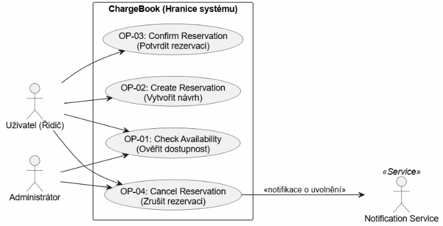

Stavový diagram rezervace:

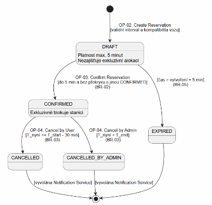

Aktivitní diagramy – OP-01 + OP-02, OP-03, OP-04:

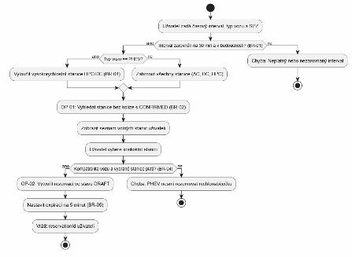

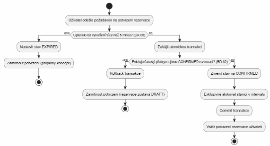

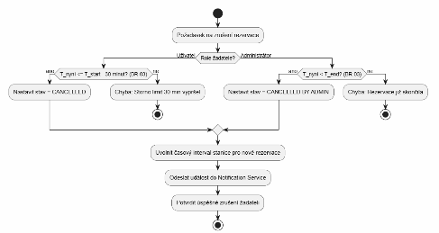

### Kontrola konzistence (v0.1)

| Kontrolovaná oblast | Nalezený rozpor / riziko | Řešení v baseline |
| --- | --- | --- |
| Create vs. Confirm | V dřívějším návrhu se zvažoval měkký zámek už při DRAFT. | Create jen eviduje záměr a ověřuje formální pravidla. Stanice se alokuje až při atomickém Confirm. |
| Availability vs. Confirm | Které stavy blokují stanici. | Ve v0.1 blokuje jen CONFIRMED, DRAFT ne. |
| Cancel vs. stavový diagram | Původní stavový diagram měl i přechod DRAFT → CANCELLED, OP-04 ale pracovala jen s CONFIRMED. | Uživatel ruší jen CONFIRMED. DRAFT se neruší, po 5 minutách sám přejde do EXPIRED. |
| Sémantika intervalů | Riziko, že někde bude uzavřený interval. | Všude [T_start, T_end) po 30 min, hraniční časy nekolidují ([10:00, 10:30) a [10:30, 11:00) jsou v pořádku). |
| Use case vs. text | Vazba na Notification Service a role administrátora. | Notification Service je ve v0.1 napojená jen na Cancel. Administrátor je u Check Availability a Cancel. |
| Požadavky vs. architektura | V požadavcích byly zmínky o konkrétní DB (PostgreSQL transakce). | Odstraněno, zůstal jen požadavek na atomické potvrzení (REQ-04). |
| Nejistota vs. vymyšlené hodnoty | 5 min na expiraci návrhu a 30 min na storno. | Obě hodnoty jsou vědomě stanovené jako parametry baseline v BR-03 a BR-05. |
| Čísla pravidel *(doplněno při převodu do repa)* | OP-01 a OP-02 odkazovaly na vlastní čísla (BR-02 Compatibility, BR-03 Expiration / Exclusive Allocation), která nesedí s katalogem. | Opraveno, všude se odkazuje na katalog (BR-02 nepřekrývání, BR-04 vůz, BR-05 expirace). |

---

## Část 2 – Změna C02 a Specification Baseline v0.2

**Stav: Specification Baseline v0.2 – platná. Aplikace jí odpovídá od tagu `v0.2.3`.**

**Změna C02:** Některé stanice vyžadují schválení oprávněnou osobou dřív, než se rezervace může stát CONFIRMED. Schválení může být opožděno, zamítnuto nebo může vypršet.

### Analýza dopadu

| Oblast | Otázka | Rozhodnutí týmu |
| --- | --- | --- |
| Create | Mění se Create, nebo dál jen vytváří DRAFT? | Nemění se. Create dál jen ověří vstup (BR-01, BR-04) a vytvoří DRAFT s expirací 5 minut, bez alokace. |
| Availability | Blokuje PENDING_APPROVAL stanici? Proč? | Ano. Aby admin neschvaloval termín, který mezitím obsadil někdo jiný, drží žádost slot až do schválení, zamítnutí nebo vypršení lhůty. |
| Confirm | Je Confirm dál okamžitý, nebo se rozdělí? | Podle stanice. AC: okamžitě DRAFT → CONFIRMED jako dřív. DC/HPC: „Potvrdit“ je žádost o schválení (DRAFT → PENDING_APPROVAL), do CONFIRMED se dostane až rozhodnutím admina. |
| Approve | Vzniká nový cíl / operace? Kdo ji smí provést? | Ano, OP-05 Approve / Reject. Smí ji provést jen uživatel s rolí Admin (záložka Schvalování). |
| Cancel | Lze zrušit PENDING_APPROVAL? | Ano. Vlastník i admin můžou žádost stáhnout (PENDING_APPROVAL → CANCELLED). |
| Stavový diagram | Jaké stavy přibývají? | PENDING_APPROVAL, REJECTED a EXPIRED i pro žádost, o které admin nerozhodl včas. |
| Use case | Přibyl aktér nebo cíl? | Aktér Admin získává nový cíl OP-05. |
| Ověření | Jak ověřit zpoždění, zamítnutí, vypršení? | Schválení v lhůtě (CONFIRMED), zamítnutí (uvolnění slotu), vypršení lhůty před začátkem (EXPIRED a uvolnění slotu). |
| Architektura | Vzniká nový driver? | Ano: časovač pro vypršení lhůty, atomická alokace při souběhu a asynchronní notifikace o výsledku. |

### Dopad změny C02

**Změněná podmínka:**
Rezervace rychlých stanic – DC (≥ 50 kW) a HPC, tj. DC 07 a HPC 08–10 – už nevznikají okamžitým potvrzením. Potvrzení (OP-03) z nich vytvoří žádost PENDING_APPROVAL, kterou musí administrátor schválit nejpozději v T_start − 15 min. Do rozhodnutí žádost blokuje stanici. Na AC stanicích (< 50 kW) zůstává okamžité potvrzení DRAFT → CONFIRMED.

**Dotčené požadavky / části specifikace:**
- OP-01 Check Availability – REQ-01 (nedostupnost způsobuje i překryv s PENDING_APPROVAL), referenced rules, příklady ověření, krok vyhledání v aktivitním diagramu.
- OP-03 Confirm Reservation – goal, REQ-03, REQ-04, preconditions, success postcondition, změna stavu, failure outcomes, příklady ověření, aktivitní diagram (větvení AC × DC/HPC).
- OP-04 Cancel Reservation – REQ-05, REQ-06, preconditions a postconditions rozšířené o stažení žádosti PENDING_APPROVAL, nové příklady ověření, aktivitní diagram.
- BR-02 (blokující stavy), BR-03 (stažení žádosti), nové BR-06 Approval policy.
- Diagram případů užití a stavový diagram; nová operace OP-05 Approve / Reject Reservation.

**Nedotčené požadavky / části + proč:**
- OP-02 Create Reservation (REQ-02) – Create jen eviduje záměr (DRAFT na 5 min) a stanici nealokuje. Schvalování se týká až alokace, takže vstupy, validace i výsledek jsou stejné pro AC i DC/HPC.
- BR-01 – časový model se nemění; lhůta T_start − 15 min se odvozuje od zarovnaného T_start.
- BR-04 – schválení je další podmínka alokace, nemění, kdo smí na kterou stanici (PHEV dál nesmí na HPC; na DC 07 smí, ale podléhá schválení).
- BR-05 – DRAFT dál propadá po 5 minutách; lhůta žádosti je samostatné pravidlo BR-06.
- OP-04 pro stav CONFIRMED – storno uživatelem nejpozději 30 min předem (CANCELLED) a administrátorem do T_end (CANCELLED_BY_ADMIN) se nemění, stejně jako napojení OP-04 na Notification Service.
- Role Uživatel – nemá nový cíl ani novou akci; „Potvrdit“ zůstává jedna akce, liší se jen výsledek podle stanice.

**Nový aktér / operace:**
Nový aktér nevzniká – Administrátor je v diagramu případů užití už ve v0.1 (OP-01, OP-04). Získává nový cíl OP-05 Approve / Reject Reservation (dvě varianty rozhodnutí o téže žádosti). Notification Service je nově napojená i na OP-05 (žadatel se dozví výsledek).

**Změněná pravidla / význam stavů:**
- BR-02 (změněno): blokující stavy jsou CONFIRMED a PENDING_APPROVAL.
- BR-03 (doplněno): žádost PENDING_APPROVAL smí vlastník i admin stáhnout kdykoliv před rozhodnutím → CANCELLED; 30min limit platí jen pro CONFIRMED.
- BR-06 (nové): stanice ≥ 50 kW vyžadují schválení do T_start − 15 min.
- PENDING_APPROVAL (nový): žádost čeká na rozhodnutí admina; blokuje stanici.
- REJECTED (nový, koncový): žádost zamítnutá adminem; neblokuje.
- EXPIRED (rozšířen): propadlý DRAFT (BR-05) nebo žádost, o které nikdo nerozhodl do T_start − 15 min (BR-06); neblokuje.
- CONFIRMED: vzniká dvěma cestami – okamžitě na AC stanici (OP-03), nebo schválením na DC/HPC (OP-05). CANCELLED nově zahrnuje i staženou žádost. DRAFT a CANCELLED_BY_ADMIN beze změny.

**Změna diagramu případů užití:**
Přibyl případ užití OP-05 Approve / Reject s vazbou Administrátor → OP-05 a OP-05 → Notification Service. Ostatní vazby (Uživatel → OP-01 až OP-04, Administrátor → OP-01 a OP-04, OP-04 → Notification Service) beze změny.

**Změna stavového diagramu:**
Nové stavy PENDING_APPROVAL a REJECTED. Přechod DRAFT → CONFIRMED (OP-03) platí nově jen pro AC stanice; nový přechod DRAFT → PENDING_APPROVAL (OP-03, DC/HPC, T_now ≤ T_start − 15 min). Z PENDING_APPROVAL vedou přechody → CONFIRMED (OP-05 Approve), → REJECTED (OP-05 Reject), → CANCELLED (OP-04 vlastník / admin) a → EXPIRED (T_now > T_start − 15 min). Beze změny: DRAFT → EXPIRED (BR-05), CONFIRMED → CANCELLED / CANCELLED_BY_ADMIN.

**Nové příklady ověření** (V1–V10, stejné označení používá evidence a `scripts/verify_c02.py`):
- V1: BEV potvrdí návrh HPC 08 [10:00, 11:00) v 08:00 → PENDING_APPROVAL, termín rozhodnutí 09:45.
- V2: Při žádosti z V1: OP-01 BEV + HPC 08 [10:30, 11:30) → UNAVAILABLE; potvrzení kolidujícího návrhu jiného uživatele → odmítnuto, zůstává DRAFT.
- V3: PHEV potvrdí AC 01 [10:00, 10:30) → rovnou CONFIRMED (bez schválení).
- V4: Admin schválí žádost z V1 v 09:00 → CONFIRMED, žadatel dostane notifikaci.
- V5: Admin zamítne žádost DC 07 [12:00, 13:00) → REJECTED, OP-01 → AVAILABLE, žadatel dostane notifikaci.
- V6: O žádosti HPC 09 [10:00, 10:30) nikdo nerozhodne; v 09:46 → EXPIRED, OP-01 → AVAILABLE; pozdní schválení → odmítnuto.
- V7: Vlastník stáhne žádost HPC 10 [10:00, 10:30) v 09:40 (20 min před začátkem) → CANCELLED, slot je volný.
- V8: Potvrzení návrhu DC 07 [10:00, 10:30) v 09:46 → odmítnuto (na schválení nezbývá čas), zůstává DRAFT.
- V9: Uživatel bez role Admin zkusí žádost schválit → odmítnuto (403), stav zůstává PENDING_APPROVAL.
- V10: Deset souběžných potvrzení kolidujících návrhů na HPC 08 → právě jeden PENDING_APPROVAL, ostatní odmítnuty (REQ-04).

**Architektonické drivery pro C03:**
- AD-1 Časově řízené přechody: DRAFT → EXPIRED (5 min) a PENDING_APPROVAL → EXPIRED (T_start − 15 min) musí nastat i bez aktivity uživatelů a vyvolat navazující akce (uvolnění slotu, notifikace) → plánovač / worker.
- AD-2 Atomická alokace při souběhu: BR-02 nově hlídají dvě operace (OP-03, OP-05) nad dvěma blokujícími stavy; při 10× souběhu (future pressure Q) musí být kontrola a zápis atomické.
- AD-3 Spolehlivé asynchronní notifikace: výsledek schválení / zamítnutí a uvolnění slotu se nesmí ztratit ani blokovat či zvrátit doménovou transakci.
- AD-4 Autorizace podle role: OP-05 je první operace jen pro roli Admin – kontrola musí být na serveru u každé operace (ne jen v UI) a rozhodnutí by mělo být dohledatelné.

### OP-01 — Check Availability (v0.2)

*Změněno: REQ-01, referenced rules, příklady ověření, aktivitní diagram. Beze změny: goal, preconditions, success postcondition.*

**Observable requirement:**
REQ-01 (v0.2): Systém vyhodnotí stanici jako nedostupnou pro zadaný interval, pokud se interval překrývá s existující rezervací ve stavu CONFIRMED nebo PENDING_APPROVAL na téže stanici. Pro vozy typu PHEV systém vysokorychlostní stanice (HPC) vždy označí jako nedostupné. U volných DC/HPC stanic systém uvede, že potvrzení bude vyžadovat schválení.

**Referenced rules:**
BR-01 (beze změny), BR-02 v0.2 (blokuje CONFIRMED i PENDING_APPROVAL, DRAFT ne), BR-04 (beze změny), BR-06 (jen informace u volných DC/HPC stanic).

**Verification examples (doplněno):**
- Existující PENDING_APPROVAL na HPC 08 [10:00, 11:00): BEV + HPC 08 [10:30, 11:30) → UNAVAILABLE (žádost čeká na schválení).
- Tatáž žádost po zamítnutí (REJECTED) nebo propadnutí (EXPIRED): BEV + HPC 08 [10:00, 11:00) → AVAILABLE.
- Příklady v0.1 s CONFIRMED na HPC 08 platí beze změny.

### OP-03 — Confirm Reservation (v0.2)

*Změněno: goal, REQ-03, REQ-04, preconditions (doplněno), success postcondition, state change, failure outcomes, příklady ověření, aktivitní diagram. Beze změny: trigger.*

**Goal / user value:**
Platný návrh (DRAFT) se stane závaznou alokací stanice (AC), nebo podmíněnou alokací, která čeká na schválení administrátorem (DC/HPC).

**Observable requirements:**
REQ-03 (v0.2): Systém přijme potvrzení rezervace ve stavu DRAFT pouze tehdy, pokud nevypršela její 5minutová platnost, její začátek je v budoucnu a interval nekoliduje s žádnou rezervací ve stavu CONFIRMED ani PENDING_APPROVAL na dané stanici. Na AC stanici (< 50 kW) rezervace přejde do CONFIRMED; na DC/HPC stanici (≥ 50 kW) přejde do PENDING_APPROVAL, a to jen pokud T_now ≤ T_start − 15 min.

REQ-04 (v0.2): Při souběžných pokusech o potvrzení kolidujících intervalů na stejné stanici smí do blokujícího stavu (CONFIRMED nebo PENDING_APPROVAL) přejít nanejvýš jedna rezervace.

**Preconditions:**
- Rezervace existuje, patří uživateli, je ve stavu DRAFT a od vytvoření neuplynulo víc než 5 minut (beze změny).
- *(nové)* T_now < T_start; pro DC/HPC navíc T_now ≤ T_start − 15 min.

**Success postcondition:**
- AC: rezervace je CONFIRMED a blokuje stanici.
- DC/HPC: rezervace je PENDING_APPROVAL, blokuje stanici, má termín rozhodnutí T_start − 15 min a je ve frontě administrátora.
- BR-02 zůstává zachováno.

**State change:** DRAFT → CONFIRMED [AC] | DRAFT → PENDING_APPROVAL [DC/HPC] | DRAFT → EXPIRED [> 5 min]

**Referenced rules:** BR-02 (v0.2), BR-04, BR-05, BR-06.

**Failure outcomes:**
- Interval koliduje s CONFIRMED nebo PENDING_APPROVAL → odmítnuto; stav zůstává DRAFT.
- Vypršel limit 5 minut → odmítnuto; rezervace je označena EXPIRED (beze změny).
- Neplatný výchozí stav → odmítnuto; stav se nemění (beze změny).
- *(nové)* DC/HPC a T_now > T_start − 15 min → odmítnuto (na schválení nezbývá čas); stav zůstává DRAFT.

**Verification examples:**
- DRAFT AC 01 bez kolize, do 5 minut → CONFIRMED (beze změny)
- DRAFT HPC 08 [10:00, 11:00) potvrzený v 08:00 → PENDING_APPROVAL, termín rozhodnutí 09:45
- DRAFT HPC 08 [10:30, 11:30), zatímco [10:00, 11:00) je PENDING_APPROVAL → odmítnuto, zůstává DRAFT
- DRAFT DC 07 [10:00, 10:30) potvrzený v 09:46 → odmítnuto, zůstává DRAFT; potvrzený v 09:45 → PENDING_APPROVAL
- deset souběžných potvrzení kolidujících DRAFT na HPC 08 → právě jeden PENDING_APPROVAL, ostatní odmítnuty

### OP-04 — Cancel Reservation (v0.2)

*Změněno: REQ-05, REQ-06, preconditions, success postcondition, failure outcomes, příklady ověření, aktivitní diagram. Beze změny: goal a pravidla pro CONFIRMED.*

**Observable requirements:**
REQ-05 (v0.2): Pro rezervace ve stavu CONFIRMED beze změny (uživatel nejpozději 30 minut před začátkem, administrátor kdykoliv před koncem). Nově: vlastník i administrátor můžou stáhnout žádost ve stavu PENDING_APPROVAL kdykoliv, dokud čeká na rozhodnutí; výsledný stav je CANCELLED.

REQ-06 (v0.2): Po úspěšném zrušení rezervace CONFIRMED nebo stažení žádosti PENDING_APPROVAL stanice okamžitě přestává být blokována a systém odešle událost o uvolnění slotu do Notification Service.

**Preconditions:**
Rezervace existuje ve stavu CONFIRMED nebo PENDING_APPROVAL; časové podmínky (30 min / T_end) platí jen pro CONFIRMED.

**Success postcondition (doplněno):**
PENDING_APPROVAL → CANCELLED (vlastník i administrátor); stanice není blokována; Notification Service je notifikována.

**Failure outcomes (doplněno):**
- Pokus zrušit DRAFT → odmítnuto (DRAFT se neruší, sám propadne – BR-05).
- Pokus zrušit REJECTED nebo EXPIRED → odmítnuto (koncový stav).
- *(doplněno při převodu do repa)* Souběh se zrušením: operace nad stejnou rezervací (OP-03, OP-04, OP-05) proběhnou jedna po druhé a každá se vyhodnotí podle stavu, který nechala ta předchozí. Když vlastník stáhne žádost dřív, než o ní admin rozhodne, rozhodnutí se odmítne. Když admin dřív schválí, zrušení se posuzuje jako u CONFIRMED (30 min předem); když dřív zamítne, zrušení se odmítne. Souběh Cancel × Confirm nenastane, protože DRAFT zrušit nejde.

**Verification examples (doplněno):**
- PENDING_APPROVAL na HPC 08 s T_start 10:00, vlastník ruší v 09:40 → CANCELLED, slot je volný (30min limit se na žádost nevztahuje).
- PENDING_APPROVAL, administrátor ruší → CANCELLED, vlastník dostane notifikaci.
- PENDING_APPROVAL na HPC 08 [10:00, 10:30), v 09:40 ji vlastník stáhne a admin ji pak schvaluje → odmítnuto, zůstává CANCELLED.
- PENDING_APPROVAL na HPC 09 [10:00, 10:30), v 09:40 ji admin schválí a vlastník ji pak ruší → odmítnuto (storno limit 30 min), zůstává CONFIRMED.
- Příklady v0.1 (CONFIRMED s T_start 14:00: 13:15 → CANCELLED, 13:40 → odmítnuto, admin 13:50 → CANCELLED_BY_ADMIN) platí beze změny.

### OP-05 — Approve / Reject Reservation (nová operace)

**Goal / user value:**
Administrátor rozhodne o žádosti na rychlou stanici (DC/HPC) dřív, než se stanice závazně přidělí. Schválením z ní udělá závaznou rezervaci, zamítnutím uvolní termín pro ostatní.

**Trigger:**
Administrátor na záložce Schvalování zvolí u žádosti „Schválit“ nebo „Zamítnout“.

**Observable requirements:**
REQ-07: Systém převede rezervaci ze stavu PENDING_APPROVAL do CONFIRMED pouze na pokyn uživatele s rolí Admin a pouze pokud T_now ≤ T_start − 15 min.

REQ-08: Systém na pokyn uživatele s rolí Admin převede rezervaci ze stavu PENDING_APPROVAL do REJECTED; stanice v intervalu okamžitě přestane být blokována.

REQ-09: O výsledku rozhodnutí systém odešle událost do Notification Service (žadateli; při zamítnutí i o uvolnění slotu).

**Preconditions:**
- Aktér je přihlášen a má roli Admin.
- Rezervace existuje a je ve stavu PENDING_APPROVAL.
- Pro schválení: T_now ≤ T_start − 15 min (BR-06).

**Success postcondition:**
- Approve: rezervace je CONFIRMED a dál blokuje stanici (blokace trvá nepřetržitě od PENDING_APPROVAL).
- Reject: rezervace je REJECTED, neblokuje stanici, záznam zůstává v historii.
- Notification Service dostala událost o výsledku.

**State change:** PENDING_APPROVAL → CONFIRMED (Approve) | PENDING_APPROVAL → REJECTED (Reject)

**Referenced rules:** BR-02 (v0.2), BR-06.

**Main success scenario:**
1. Administrátor otevře frontu žádostí PENDING_APPROVAL seřazenou podle termínu rozhodnutí.
2. Vybere žádost a zvolí Schválit, nebo Zamítnout.
3. Systém ověří roli Admin a že lhůta T_start − 15 min neuplynula (BR-06).
4. Systém atomicky ověří stav PENDING_APPROVAL a změní ho na CONFIRMED, resp. REJECTED.
5. Systém odešle událost do Notification Service.

**Alternative / failure outcomes:**
- Aktér nemá roli Admin → odmítnuto (403); stav se nemění.
- Rezervace není ve stavu PENDING_APPROVAL (už rozhodnutá nebo stažená) → odmítnuto; stav se nemění.
- Rozhodnutí po lhůtě T_start − 15 min → odmítnuto; žádost je označena EXPIRED a stanice uvolněna.

**Verification examples:**
- PENDING_APPROVAL HPC 08 [10:00, 11:00), admin schválí v 09:00 → CONFIRMED, žadatel dostane notifikaci
- tatáž žádost, admin schválí v 09:45 → CONFIRMED (hranice lhůty je ještě povolená)
- tatáž žádost, admin schválí v 09:50 → odmítnuto, stav EXPIRED, OP-01 hlásí HPC 08 jako AVAILABLE
- admin žádost zamítne → REJECTED, OP-01 hlásí HPC 08 [10:00, 11:00) jako AVAILABLE, žadatel dostane notifikaci
- uživatel bez role Admin volá schválení → 403, stav zůstává PENDING_APPROVAL

**Rationale:**
Teprve ve v0.2 má Approve samostatný engineering význam. Ve v0.1 byla alokace jeden atomický krok uživatele (OP-03). Teď se rozpadá na dva kroky dvou aktérů, mezi kterými stanici drží PENDING_APPROVAL, aby admin neschvaloval termín, který mezitím obsadil někdo jiný. Schválení proto kolize znovu nehledá – potvrzuje alokaci, která už existuje – ale hlídá roli a lhůtu. Tím vzniká nový časově řízený přechod (EXPIRED) a nová notifikace, tedy drivery pro C03.

### Doménová pravidla (změny ve v0.2)

**BR-02 — Exclusive Resource invariant (v0.2, změněno)**
V žádném stavu systému se nesmí dvě rezervace v blokujícím stavu – CONFIRMED nebo PENDING_APPROVAL – na stejné stanici časově překrývat. DRAFT, CANCELLED, CANCELLED_BY_ADMIN, REJECTED a EXPIRED stanici neblokují.

**BR-03 — Cancellation policy (v0.2, doplněno)**
Pravidla pro CONFIRMED beze změny. Žádost ve stavu PENDING_APPROVAL smí vlastník i administrátor stáhnout kdykoliv před rozhodnutím; přechází do CANCELLED a uvolňuje stanici. Zrušení zachovává auditní stopu (soft delete).

**BR-06 — Approval policy (nové)**
Stanice s výkonem ≥ 50 kW (DC 07, HPC 08–10) vyžadují schválení administrátorem. Potvrzení (OP-03) na takové stanici vytvoří žádost PENDING_APPROVAL, pouze pokud T_now ≤ T_start − 15 min. O žádosti musí administrátor rozhodnout (OP-05) nejpozději v T_start − 15 min; když nerozhodne, žádost přechází do EXPIRED a stanice se uvolní. Lhůta 15 minut nechává čas oznámit žadateli výsledek před příjezdem ke stanici.

BR-01, BR-04 a BR-05 platí beze změny podle v0.1.

### Diagramy v0.2

Diagram případů užití:

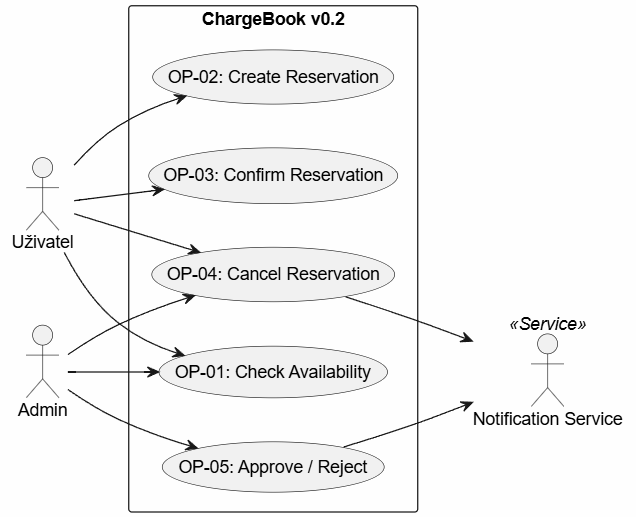

Stavový diagram rezervace (zdroj [state_v02.puml](diagrams/state_v02.puml)):

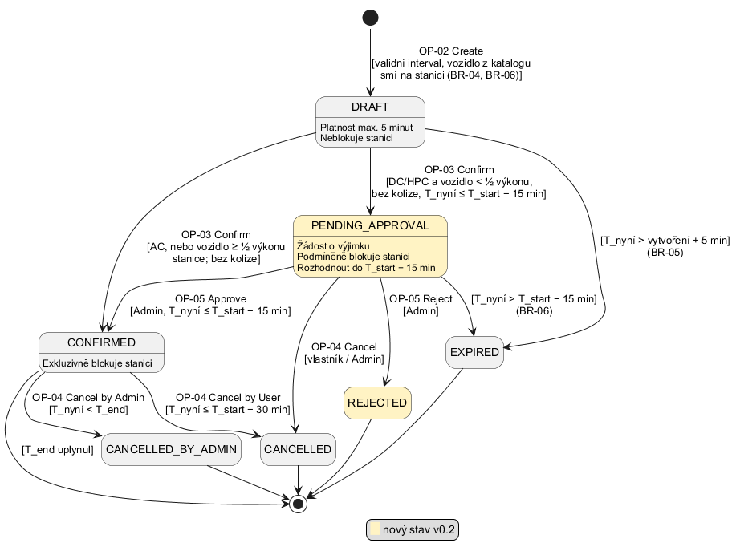

Aktivitní diagramy – OP-01 + OP-02, OP-03, OP-04, OP-05:

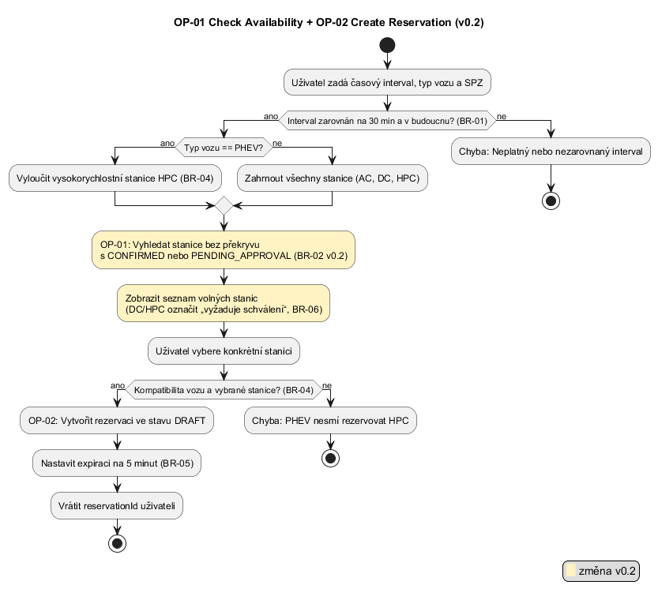

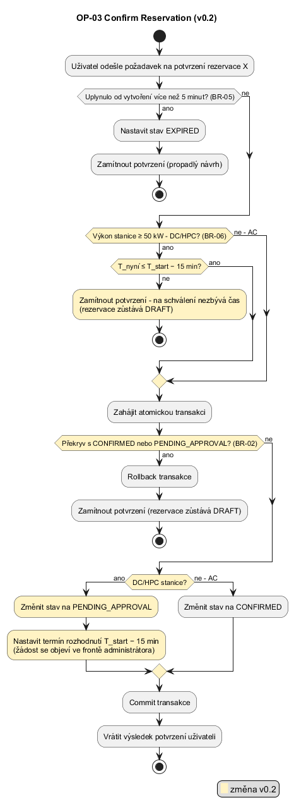

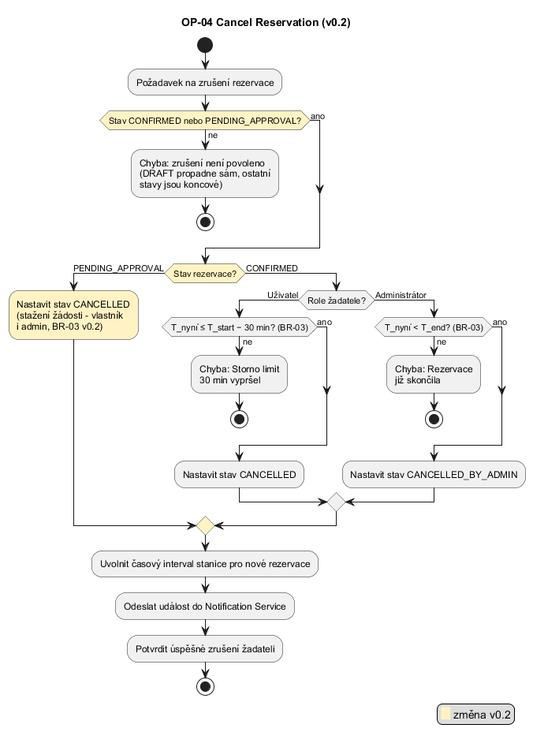

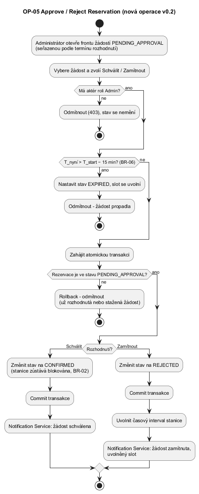

### Kde jsou požadavky ověřené

Testy běží přes `python -m pytest` (soubor `tests/test_reservations.py`, pokud není uvedeno jinak), příklady V1–V9 navíc přes HTTP skriptem `scripts/verify_c02.py`.

| Požadavek / pravidlo | Testy | Příklady |
| --- | --- | --- |
| REQ-01 (OP-01) | `test_op01_examples_with_confirmed_on_hpc08`, `test_op01_v02_pending_approval_blocks_station`, `test_op01_draft_does_not_block` | V2 |
| REQ-02 (OP-02) | `test_op02_example_*` (4 příklady), `test_op02_does_not_check_collisions`, `tests/test_web.py::test_cp1_*` | – |
| REQ-03 (OP-03) | `test_op03_ac_draft_without_collision_is_confirmed_immediately`, `test_op03_v02_dc_hpc_draft_goes_to_pending_approval`, `test_op03_collision_with_confirmed_is_rejected_and_stays_draft`, `test_op03_v02_collision_with_pending_approval_is_rejected`, `test_op03_draft_older_than_5_minutes_is_expired`, `test_op03_v02_dc_confirm_less_than_15_minutes_before_start_is_rejected` | V1, V2b, V3, V8 |
| REQ-04 (OP-03) | `test_op03_req04_concurrent_confirms_allow_exactly_one` | V10 |
| REQ-05 (OP-04) | `test_op04_user_cancels_at_13_15_is_cancelled_and_slot_free`, `test_op04_user_cancels_at_13_40_is_rejected`, `test_op04_admin_cancels_at_13_50_is_cancelled_by_admin`, `test_op04_v02_user_withdraws_pending_request_without_30_minute_limit`, `test_op04_rejects_draft_terminal_states_and_foreign_user`, `test_op04_v02_withdraw_and_admin_decision_see_state_left_by_the_other` | V7 |
| REQ-06 (OP-04) | `test_released_hpc_slot_notifies_draft_owner_and_eligible_lower_power_users`, `test_released_dc_slot_notifies_phev_on_weaker_station` | – |
| REQ-07 (OP-05) | `test_op05_admin_approves_in_time_and_requester_is_notified`, `test_op05_approve_exactly_at_deadline_is_allowed`, `test_op05_approve_after_deadline_is_rejected_request_expired_and_slot_free`, `test_op05_non_admin_cannot_approve_or_reject` | V4, V6, V9 |
| REQ-08 (OP-05) | `test_op05_reject_releases_slot_and_notifies_requester` | V5 |
| REQ-09 (OP-05) | notifikace v testech V4 a V5 výše, doručení přes outbox (od C03) `test_adr01_*` | V4, V5 |
| BR-02 i mimo službu | `test_db_triggers_enforce_approval_policy_overlap_and_transitions` | – |
| BR-05, BR-06 propadnutí | `test_br05_unconfirmed_draft_expires_without_any_operation`, `test_br06_undecided_request_expires_and_releases_slot` | V6 |
